<a href="https://rahulsangral.me"></a>

  
  
  
  





  
  
  
  
  



<table>
<tr><td width="50%"><a href="https://zyphix.in"></a></td><td width="50%"><a href="https://github.com/sangralrahul/sentinel-z"></a></td></tr>
<tr><td width="50%"><a href="https://github.com/sangralrahul/SQLFixEnv"></a></td><td width="50%"><a href="https://github.com/sangralrahul/CodeDebugEnv"></a></td></tr>
<tr><td width="50%"><a href="https://github.com/sangralrahul/inrisk-weather-explorer"></a></td><td width="50%"><a href="https://github.com/sangralrahul/employee-attendance-api"></a></td></tr>
<tr><td width="50%"><a href="https://daylit5.vercel.app"></a></td><td width="50%"><a href="https://github.com/sangralrahul/CIVICPULSEAGENT"></a></td></tr>
</table>

Also: <a href="https://github.com/sangralrahul/REFLECT-AI">ReflectAI</a> (Gemini journaling on Firebase) · <a href="https://github.com/sangralrahul/NESTOOD">NESTOOD</a> (construction site with cost calculator) · <a href="https://github.com/sangralrahul/RAHUL-LEETCODE">LeetCode solutions</a>




  
   
  

  
  
  
  
  
  
  
  
  
  


  
  
  
  
  
  
  
  
  
  

  

  
  

  

  

  <picture>
    <source media="(prefers-color-scheme: dark)" srcset="https://raw.githubusercontent.com/sangralrahul/sangralrahul/output/github-snake-dark.svg">
    
  </picture>


  
  
  
  
  
  

The quickest way to reach me is <a href="mailto:hello@rahulsangral.me">hello@rahulsangral.me</a>. I usually reply within a day.

