  
  
  
  

Founder of **[AETHEX](https://aethex.in)**, a medical workspace for India's doctors, hospitals and medical colleges, and of **[Cadus](https://cadus.aethex.in)**, the clinical AI built into it. I design the APIs and data, build the web and desktop apps, and run the releases: React, TypeScript, FastAPI, PostgreSQL and AI.

Founding Software Engineer at Clavix Technologies, graduating in 2026 (BCA, Uttaranchal University). Open to **SDE-1 / New Grad roles**, remote or on-site, and to freelance work.

## AETHEX

| Product | Who it's for | What it does | Status |
|---|---|---|---|
| **[aethex.in](https://aethex.in)** | Doctors and medical students | Medical store, study hub and Cadus in the browser. React + TypeScript frontend, FastAPI API, PostgreSQL and Firestore, role-based auth, Razorpay subscriptions, GA4, CI/CD on Vercel and Railway. | Live |
| **[Cadus](https://cadus.aethex.in)** | Clinicians and students | Clinical AI assistant. Every answer carries sources and passes a safety review for doses and red flags before it is shown. Runs on the Medius 3.1 and Magnus 3.6 models. | Live |
| **[Cadus Desktop](https://downloads.aethex.in)** | Doctors who live inside hospital software | Cadus in its own window: Ctrl+Shift+Space opens a chat from any app, a tray menu keeps tools one click away, reminders surface due flashcards and ward jobs, daily update checks. Windows x64 and ARM64, Linux; macOS next. | v1.0.2 |
| **[AETHEX PC](https://hms.aethex.in)** | Doctors and students | Cadus, the offline medical library and My Clinic for a doctor's own practice. | v0.1.70 |
| **[AETHEX HC](https://hms.aethex.in)** | Hospitals and clinics | Runs a hospital from the front desk to discharge: OPD, admissions, wards and nursing, lab, pharmacy, GST billing with UPI and insurance claims. 30+ modules. | v0.1.70 |
| **[AETHEX MC](https://hms.aethex.in)** | Medical colleges | Timetable, attendance with the 75% / 80% rule, CBME logbook, exams and fees. 25+ modules. | v0.1.70 |

Three desktop apps share one aethex.in account with Google sign-in, and all of them carry the same 15,515-article medical library that works offline.

**Inside Cadus**

- A privacy guard hides patient identifiers before anything is sent; every clinical answer is safety-reviewed; answer history stays on the device.
- Reference-style answers with key points, evidence-certainty labels, dose cards and numbered sources.
- Drug-interaction checks, dosage calculations, lab-value help and an Rx Safety Check for a typed, photographed or PDF prescription.
- Deep Dive: plans the question, searches PubMed and guideline sites step by step, then writes a cited, safety-reviewed report.
- Patient cases with a vitals timeline, 16 guideline-based clinical pathways, a Case Simulator with a scored debrief and a Presentation Coach.
- Report Explainer and a two-way Consult Translator across 13 Indian languages, by voice or typing.
- Cadus Crew: 20 ready-made assistants (Viva Examiner, Clinical Pharmacist, ICU Registrar and more) or your own, with knowledge files, @mentions and Crew Huddle.

## Other work

| Project | What it is | Links |
|---|---|---|
| **Zyphix** | Hyperlocal commerce for India: groceries, food and pharmacy from trusted neighbourhood businesses. Designed, built and deployed from the ground up with modular REST APIs, a clean SQL schema and automated CI/CD. | [zyphix.in](https://zyphix.in) · [Repo](https://github.com/sangralrahul/Zyphix) |
| **Sentinel-Z** | Privacy-preserving fraud detection for banking security logs: pseudonymised, explainable, no cloud calls, runs on IBM Z. IBM Z Datathon 2026, Team Bitverse. | [Live demo](https://sentinel-z-eight.vercel.app) · [Repo](https://github.com/sangralrahul/sentinel-z) |
| **SQLFixEnv** and **CodeDebugEnv** | Two OpenEnv environments for the Meta × PyTorch OpenEnv Hackathon: agents fix broken SQL against a real SQLite database, and repair real-world buggy Python. | [SQLFixEnv](https://github.com/sangralrahul/SQLFixEnv) · [CodeDebugEnv](https://github.com/sangralrahul/CodeDebugEnv) |
| **Weather Explorer** | Climate-data pipeline for the InRisk Labs case study: Open-Meteo history archived as raw JSON in Google Cloud Storage, served by FastAPI, visualised in Next.js. | [Repo](https://github.com/sangralrahul/inrisk-weather-explorer) |
| **Employee Attendance API** | FastAPI + MongoDB punch-in / punch-out service with IST business rules, audited corrections and aggregation-pipeline analytics. | [Repo](https://github.com/sangralrahul/employee-attendance-api) |
| **Daylit** | A one-minute daily English habit with streaks, points, badges and a weekly league, built for modest Android phones and mobile data. No dependencies, no build step. | [Live](https://daylit5.vercel.app) · [Repo](https://github.com/sangralrahul/daylit) |
| **CivicPulse Agent** | Civic-issue reporting for the All Things Agentic Hackathon: classifies complaints, routes them to the right department and tracks them to resolution. | [Repo](https://github.com/sangralrahul/CIVICPULSEAGENT) |
| **ReflectAI** | Authenticated journaling and reflection assistant on Gemini, Firebase Auth and Firestore with per-user data isolation and location-aware entries. | [Repo](https://github.com/sangralrahul/REFLECT-AI) |

Also: [NESTOOD](https://github.com/sangralrahul/NESTOOD), a construction website with a cost calculator and admin panel, and my [LeetCode solutions](https://github.com/sangralrahul/RAHUL-LEETCODE).

## Stack

  
   
  

  
  
  
  
  
  
  
  
  
  

## Experience

| | | |
|---|---|---|
| **Founding Software Engineer** | Clavix Technologies (Aethex) · Remote | Nov 2025 – present |
| | Sole developer behind aethex.in and its products: the Cadus clinical AI (web and desktop) and the AETHEX PC, HC and MC desktop apps. API design, authentication, database schema, Razorpay payments, analytics and CI/CD. | |
| **Freelance Software Developer** | Independent · Remote | 2023 – present |
| | Web apps, REST APIs and automation scripts for clients across domains. | |
| **Business Development Executive (Intern)** | SND Technologies · Remote | Jan – Feb 2026 |
| | Automated KPI reporting with Python; SQL and Excel lead and conversion reports. | |
| **Software Engineering Virtual Experience** | JPMorgan Chase and Deloitte Australia (Forage) | Feb 2026 |
| | Screened financial data feeds for anomalies with Python; cleaned multi-source data for dashboards. | |

Bachelor of Computer Applications, Uttaranchal University, Dehradun (2023 – 2026).

## Certifications

- **Anthropic**: [Building with the Claude API](https://verify.skilljar.com/c/i3h2m4rcgjsm) · [Claude in Amazon Bedrock](https://verify.skilljar.com/c/7r6sf98nkkzv) · [Claude with Vertex AI](https://verify.skilljar.com/c/7bbqpvc8vzxu) (2026)
- **Oracle**: Agentic AI Certified Foundations Associate (2026)
- **McKinsey & Company**: [McKinsey Forward Program](https://www.credly.com/badges/dda78901-d85d-4aeb-866e-14d54c3c4d14) (2026)
- **Google**: [Advanced Data Analytics Professional Certificate](https://www.coursera.org/account/accomplishments/professional-cert/certificate/LF56ZWGJU6ZS)
- **Microsoft**: [AI & ML Engineering Professional Certificate](https://www.coursera.org/account/accomplishments/professional-cert/certificate/DUA346BJ4G77) · [AI & ML Algorithms and Techniques](https://www.coursera.org/account/accomplishments/verify/WHVYD6WKFM9L)
- **Cisco**: [Introduction to Data Science](https://www.credly.com/badges/86541c80-8bd8-4db6-8104-043ae00d2927) (2026)
- **JPMorgan Chase · Forage**: Software Engineering Virtual Experience (2026)

## Activity

  
  

  

  

  <picture>
    <source media="(prefers-color-scheme: dark)" srcset="https://raw.githubusercontent.com/sangralrahul/sangralrahul/output/github-snake-dark.svg">
    
  </picture>

## Elsewhere

  
  
  
  
  
  

The quickest way to reach me is <a href="mailto:hello@rahulsangral.me">hello@rahulsangral.me</a>. I usually reply within a day.

