

<table align="center">
<tr><td align="center"><a href="https://rahulsangral.me"> <b>Portfolio</b></a> rahulsangral.me </td><td align="center"><a href="https://www.linkedin.com/in/rahulsangral/"> <b>LinkedIn</b></a> in/rahulsangral </td><td align="center"><a href="mailto:hello@rahulsangral.me"> <b>Email</b></a> hello@rahulsangral.me </td><td align="center"><a href="https://rahulsangral.me/resume.pdf"> <b>Résumé</b></a> PDF </td></tr>
</table>





<table align="center">
<tr><td align="center"><a href="https://aethex.in"> <b>AETHEX</b></a> aethex.in </td><td align="center"><a href="https://cadus.aethex.in"> <b>Cadus</b></a> cadus.aethex.in </td><td align="center"><a href="https://hms.aethex.in"> <b>Desktop apps</b></a> hms.aethex.in </td><td align="center"><a href="https://downloads.aethex.in"> <b>Downloads</b></a> downloads.aethex.in </td><td align="center"><a href="https://github.com/sangralrahul/Aethex"> <b>GitHub</b></a> sangralrahul/Aethex </td></tr>
</table>



<table>
<tr><td width="50%"><a href="https://zyphix.in"></a></td><td width="50%"><a href="https://github.com/sangralrahul/sentinel-z"></a></td></tr>
<tr><td width="50%"><a href="https://github.com/sangralrahul/SQLFixEnv"></a></td><td width="50%"><a href="https://github.com/sangralrahul/CodeDebugEnv"></a></td></tr>
<tr><td width="50%"><a href="https://github.com/sangralrahul/inrisk-weather-explorer"></a></td><td width="50%"><a href="https://github.com/sangralrahul/employee-attendance-api"></a></td></tr>
<tr><td width="50%"><a href="https://daylit5.vercel.app"></a></td><td width="50%"><a href="https://github.com/sangralrahul/CIVICPULSEAGENT"></a></td></tr>
</table>

Also: <a href="https://github.com/sangralrahul/REFLECT-AI">ReflectAI</a> (Gemini journaling on Firebase) · <a href="https://github.com/sangralrahul/NESTOOD">NESTOOD</a> (construction site with cost calculator) · <a href="https://github.com/sangralrahul/RAHUL-LEETCODE">LeetCode solutions</a>



  
   
  


<table>
<tr><td align="center" width="56"></td><td><a href="https://verify.skilljar.com/c/i3h2m4rcgjsm"><b>Building with the Claude API</b></a> &nbsp;Anthropic · 2026 </td><td align="center" width="56"></td><td><a href="https://verify.skilljar.com/c/7r6sf98nkkzv"><b>Claude in Amazon Bedrock</b></a> &nbsp;Anthropic · 2026 </td></tr>
<tr><td align="center" width="56"></td><td><a href="https://verify.skilljar.com/c/7bbqpvc8vzxu"><b>Claude with Vertex AI</b></a> &nbsp;Anthropic · 2026 </td><td align="center" width="56"></td><td><a href="https://rahulsangral.me"><b>Agentic AI Certified Foundations Associate</b></a> &nbsp;Oracle · 2026 </td></tr>
<tr><td align="center" width="56"></td><td><a href="https://www.coursera.org/account/accomplishments/professional-cert/certificate/LF56ZWGJU6ZS"><b>Advanced Data Analytics</b></a> &nbsp;Google · Professional Certificate </td><td align="center" width="56"></td><td><a href="https://www.credly.com/badges/86541c80-8bd8-4db6-8104-043ae00d2927"><b>Introduction to Data Science</b></a> &nbsp;Cisco · 2026 </td></tr>
<tr><td align="center" width="56"></td><td><a href="https://www.coursera.org/account/accomplishments/professional-cert/certificate/DUA346BJ4G77"><b>AI &amp; ML Engineering</b></a> &nbsp;Microsoft · Coursera · Professional Certificate </td><td align="center" width="56"></td><td><a href="https://www.coursera.org/account/accomplishments/verify/WHVYD6WKFM9L"><b>AI &amp; ML Algorithms and Techniques</b></a> &nbsp;Microsoft · Coursera </td></tr>
<tr><td align="center" width="56"></td><td><a href="https://www.credly.com/badges/dda78901-d85d-4aeb-866e-14d54c3c4d14"><b>McKinsey Forward Program</b></a> &nbsp;McKinsey &amp; Company · Credly · 2026 </td><td align="center" width="56"></td><td><a href="https://rahulsangral.me"><b>Software Engineering Virtual Experience</b></a> &nbsp;JPMorgan Chase · Forage · 2026 </td></tr>
</table>

  <picture>
    <source media="(prefers-color-scheme: dark)" srcset="https://raw.githubusercontent.com/sangralrahul/sangralrahul/output/github-snake-dark.svg">
    
  </picture>

<table align="center">
<tr><td align="center"><a href="https://leetcode.com/u/rahulsangral/"> <b>LeetCode</b></a> rahulsangral </td><td align="center"><a href="https://codeforces.com/profile/rahulsangral"> <b>Codeforces</b></a> rahulsangral </td><td align="center"><a href="https://www.geeksforgeeks.org/user/rahulsangral/"> <b>GeeksforGeeks</b></a> rahulsangral </td><td align="center"><a href="https://www.hackerrank.com/rahulsangral"> <b>HackerRank</b></a> rahulsangral </td><td align="center"><a href="https://huggingface.co/sangralrahul"> <b>Hugging Face</b></a> sangralrahul </td><td align="center"><a href="https://www.codedex.io/@rahulsangral"> <b>Codédex</b></a> @rahulsangral </td></tr>
</table>

